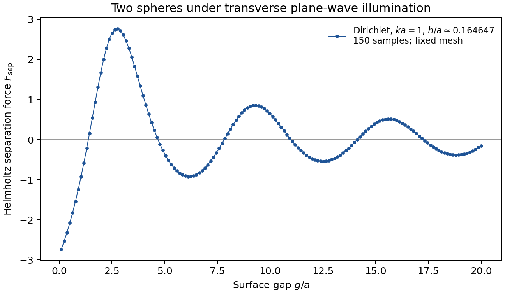

# Classical Casimir force

## Mathematical problem

Two obstacles immersed in a monochromatic acoustic field scatter the incident
wave and exert radiation forces on one another. For two spheres, does this force
attract or repel them, and how does it depend on their separation, the wavelength
and the boundary condition?

We solve the exterior Helmholtz problem in three dimensions. For obstacles
$\Omega_1,\Omega_2$, the total field satisfies

$$
\begin{aligned}
(\Delta+k^2)u&=0
&&\text{in }\mathbb{R}^3\setminus\overline{\Omega_1\cup\Omega_2},\\
u&=u^{\mathrm{inc}}+u^{\mathrm{sc}},
&&u^{\mathrm{inc}}(x)=A e^{ik d\cdot x},
\end{aligned}
$$

where $k>0$ is the wavenumber, $d$ is the incident unit direction, and the
scattered field satisfies the outgoing Sommerfeld radiation condition. The
obstacle boundaries carry either **Dirichlet** conditions $u=0$ (sound-soft)
or **Neumann** conditions $\partial_\nu u=0$ (sound-hard).

The force on each obstacle is computed from the Helmholtz stress tensor:

$$
\begin{aligned}
F_j&=-\int_{\partial\Omega_j}T[u]\nu\,dS,\\
T_{mn}[u]&=\mathrm{Re}(\partial_m u\,\overline{\partial_n u})
-\frac12\delta_{mn}\bigl(|\nabla u|^2-k^2|u|^2\bigr),
\end{aligned}
$$

with $\nu$ pointing from the obstacle into the exterior. For equal spheres of
radius $a$ on the $x$-axis, let $g$ be the surface gap, so their centre distance
is $2a+g$. The separation force is $F_{\mathrm{sep}}=(F_{2,x}-F_{1,x})/2$;
positive values mean repulsion and negative values attraction. The
[numerical report](reports/numerical-study.pdf) gives the normalization and the
conversion from Helmholtz force to acoustic force in newtons.

The project accompanies an unpublished draft paper *A classical analog of the Casimir effect,
induced by acoustic radiation pressure*. The draft relates radiation forces to position derivatives of the
scattering matrix, relative energy to the Wigner time-delay operator, and the
interaction force traced over incoming directions to the relative spectral
shift function. This last construction connects the acoustic problem to the
quantum Casimir effect.

## Computations and further work

The implementation uses the boundary element method (BEM), through Bempp-cl,
to solve Dirichlet and Neumann scattering problems. It computes boundary traces,
scattered and far fields, and the force on each obstacle. Independent force
calculations use far-field momentum balance and position derivatives of the
scattering amplitude.

The included calculations are:

- **Sphere benchmarks and two-sphere mesh studies.** Comparison with the analytic
  sphere solution gives force errors of 0.810% for Dirichlet and 1.075% for Neumann
  conditions at $h/a\approx0.164647$, where $h$ is the maximum triangle-edge length.
  Two-sphere calculations also compare boundary traction with the
  position-derivative force formula.
- **A Dirichlet separation curve at $ka=1$.** The incident wave is transverse to
  the line joining the sphere centres. The curve contains 150 equally spaced
  gaps from $g/a=0.1$ to $20$, using $h/a\approx0.164647$. It shows alternating
  attraction and repulsion, with decreasing oscillation amplitude as separation
  increases.



The [datasets and reproduction guide](examples/README.md) and
[numerical report source](reports/numerical-study.tex) contain the parameters,
measurements and figures.

Further calculations will develop the numerical illustrations for the draft:

1. Extend the separation curves to Neumann conditions and other values of $ka$
   and incident direction; quantify the oscillation, decay and force zeros.
2. Compute forces along closed paths in obstacle configuration space to
   illustrate the nonconservative force on individual obstacles, and compare
   them with the draft's position Wigner–Smith formulas.
3. Integrate over incoming directions and subtract the isolated-obstacle
   contributions. Compare the resulting interaction force with the gradient of
   the relative-scattering-phase potential, then examine the frequency-weighted
   relation to the Casimir energy described in the draft.

## Install and run locally

Use **Linux and Python 3.12**. The supplied sphere meshes are generated internally;
calculations use the CPU/Numba backend.

```bash
git clone https://github.com/qft-hofmann/Classical-Casimir-effect.git
cd Classical-Casimir-effect
python3.12 -m venv .venv
source .venv/bin/activate
python -m pip install -r requirements.lock -e '.[test]'
classical-casimir case configs/example.yaml --output output/example
```

The example computes a Dirichlet two-sphere problem with $a=k=1$, gap $g=2$ and
transverse illumination. Edit `configs/example.yaml` to select `boundary`
(`dirichlet` or `neumann`), `k`, `gap`, `direction` and mesh `refinement`.
Results in `output/example` include the force vectors, solver diagnostics and
saved field/mesh data. The first calculation includes Numba compilation.

See [local usage and the mesh-size table](docs/usage.md) for configuration,
output formats and commands for computing and plotting a series of cases.
`classical-casimir --help` lists the available commands.

To regenerate the supplied figures and report:

```bash
python scripts/plot_examples.py
python scripts/report_data.py
cd reports
latexmk -pdf -interaction=nonstopmode -halt-on-error numerical-study.tex
```

Compiling the report requires a TeX installation with PGFPlots and latexmk.

## HPC at Leibniz University Hannover

The Slurm workflow is configured for the high-performance computing cluster
operated by **Leibniz University Hannover's IT services (LUIS)**. It uses that
cluster's modules, storage layout and job scheduler.

On a Hannover cluster login node, clone into `$BIGWORK` and launch a study:

```bash
git clone https://github.com/qft-hofmann/Classical-Casimir-effect.git \
  "$BIGWORK/Classical-Casimir-effect"
cd "$BIGWORK/Classical-Casimir-effect"
bash run-hpc.sh --boundary dirichlet --ka 1 \
  --gap-min 0.1 --gap-max 20 --points 150 --mesh-size 0.2 \
  --cpus 2 --memory-gib 8 --minutes 15
```

The runner checks the configured Python environment, submits a smoke test,
computes the distance sweep as a Slurm array, and collects and plots the results.
Slurm manages task scheduling. The command-line options select the physical
parameters, mesh size and resources; `--mesh-size 0.2` selects a mesh with
$h/a\approx0.164647$. Repeating the same command resumes the run.

Site settings are in `configs/luis.json`, with personal overrides in the ignored
`configs/luis.local.json`. The supplied configuration uses the cluster-default
Miniforge module and an existing environment at `$HOME/.conda/envs/bempp`.
Run data and caches are written below `$BIGWORK`. See the
[Hannover cluster instructions](docs/luis/README.md) for environment settings,
all run options and resumption.

## Tests and citation

Run the non-BEM tests with `python -m pytest -m 'not bem'` and the numerical smoke
tests with `python scripts/smoke.py`.

Software citation metadata are in
[CITATION.cff](CITATION.cff). The code is distributed under the
[MIT license](LICENSE).
